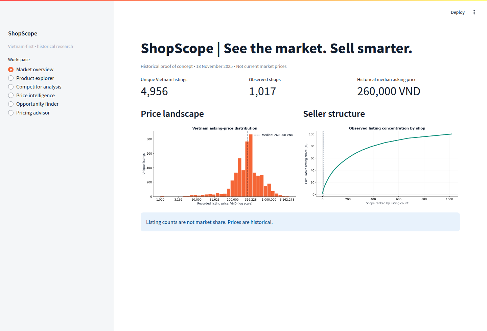
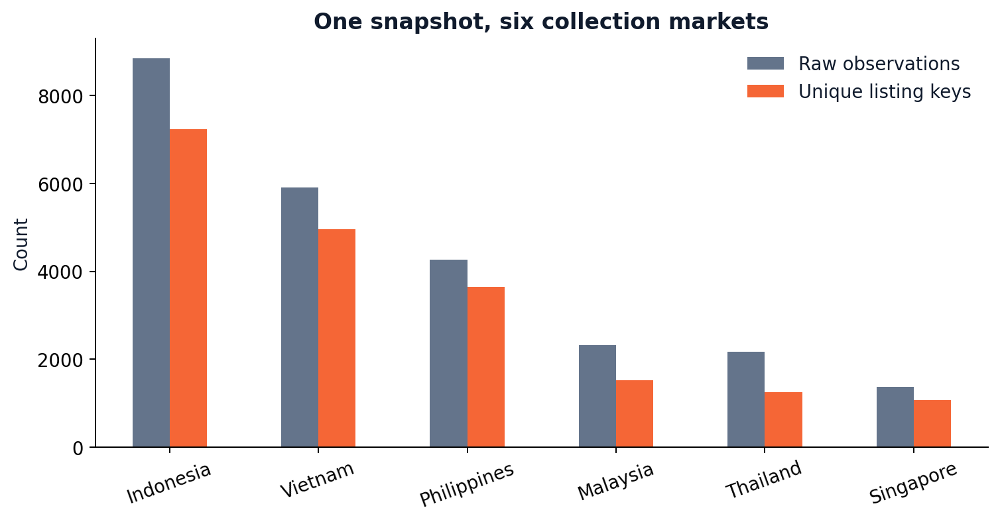
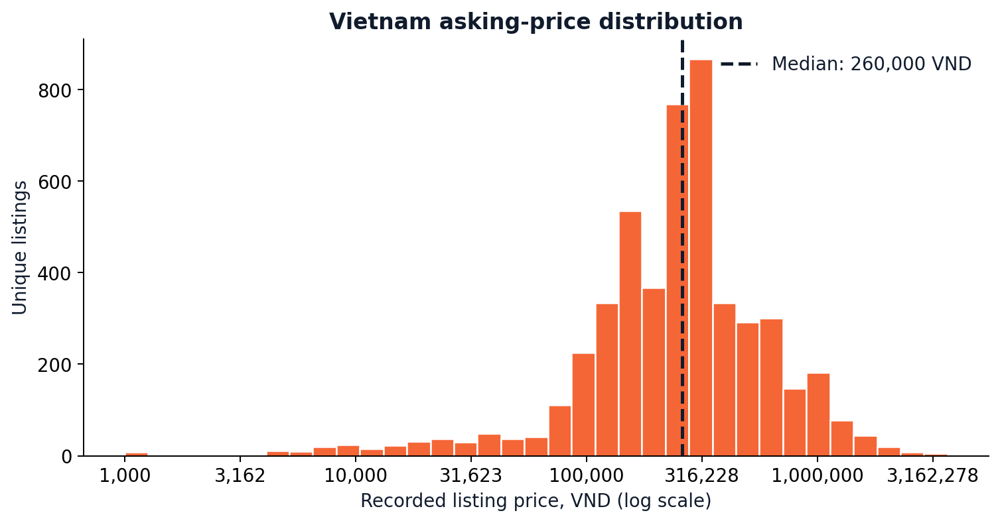
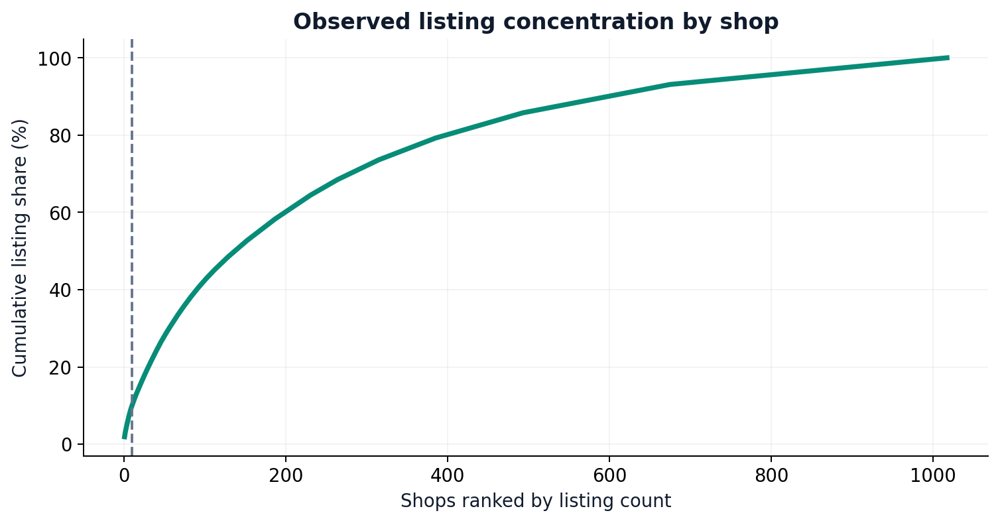
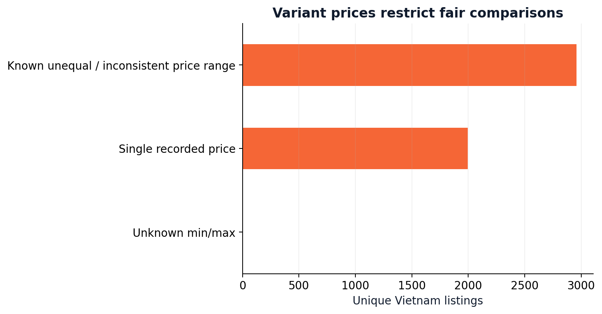
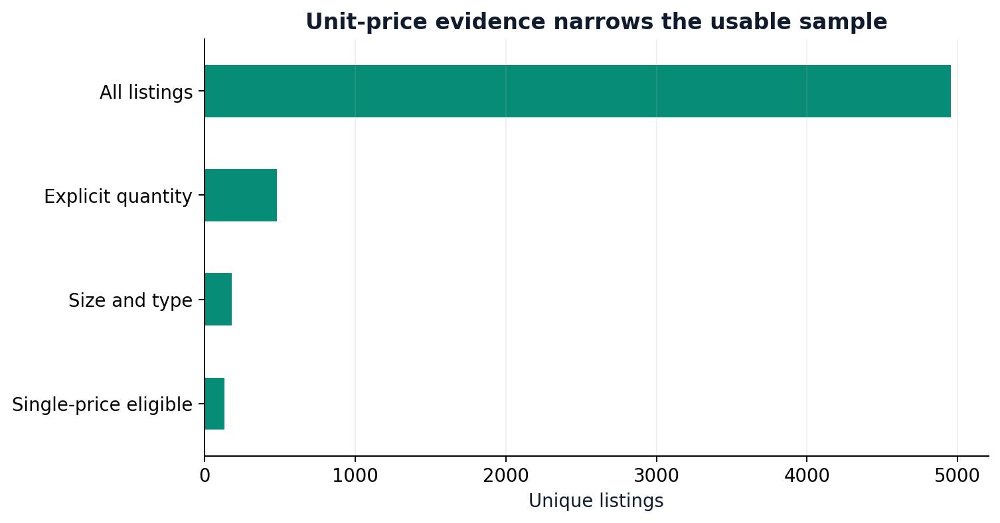
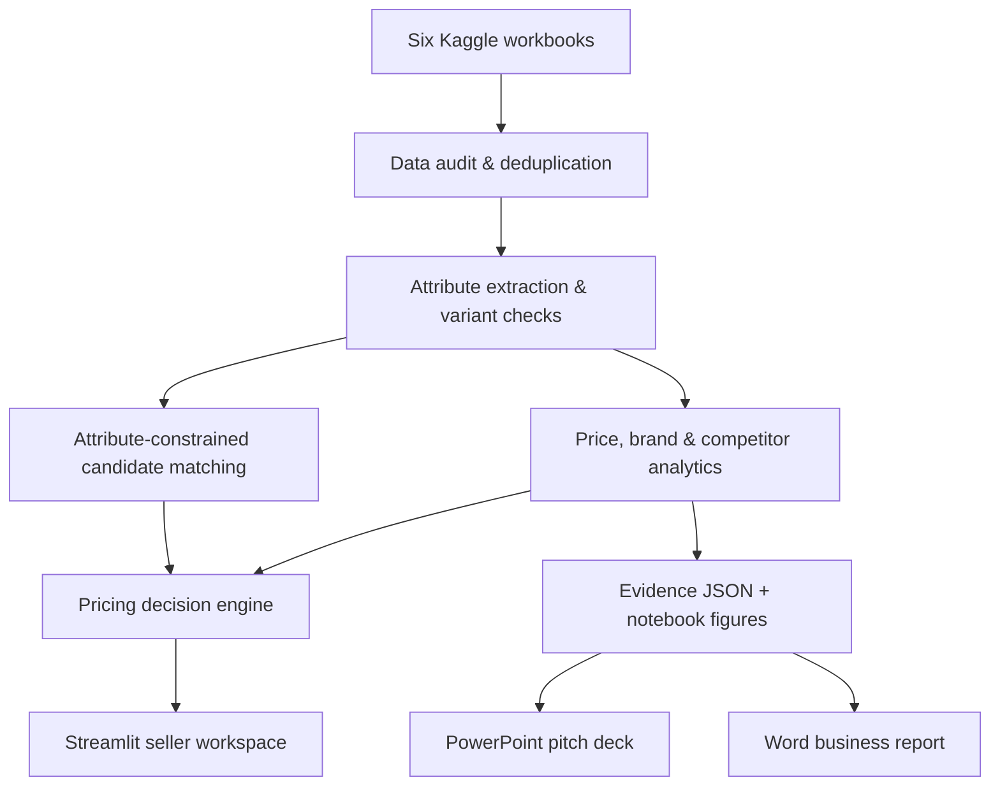
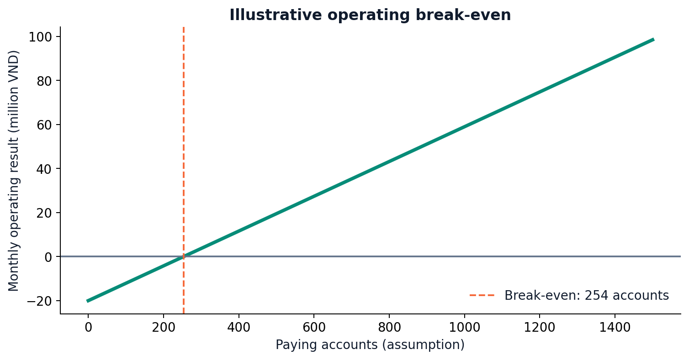

<div align="center">

# ShopScope

### See the market. Sell smarter.

**Data-driven pricing intelligence for small e-commerce sellers**

Data Entrepreneurship · Vietnam-first · Southeast Asian diaper market case study

[](https://github.com/kien-test-hehe/data-entrepreneurship/actions/workflows/build.yml)

[View the executed notebook](outputs/ShopScope_Data_Analysis.executed.ipynb) · [Pitch deck](reports/ShopScope_Startup_Pitch.pptx) · [Business report](reports/ShopScope_Business_Report.docx) · [Technical guide](docs/README-technical.md)

</div>

---

## 1. What is ShopScope?

Imagine you run a small online store and want to sell baby diapers on Shopee. How do you know which competing products are genuinely comparable, whether your price is competitive, and whether you can still make a profit after selling fees?

**ShopScope is a proposed B2B SaaS platform that transforms fragmented marketplace listings into explainable pricing and competitor insights.** We start with Vietnam's mother-and-baby sellers, using the diaper category as a focused proof of concept.

| The seller's problem | How ShopScope helps |
| --- | --- |
| Researching competitors manually takes time. | Search listings and explore observed competitors in one workspace. |
| Pack sizes, product lines and variants make prices misleading. | Extract product attributes, flag ambiguity and identify candidate matches. |
| A competitive price may not cover costs. | Calculate a seller-specific price floor and compare it with available evidence. |
| Market opportunities are difficult to prioritize. | Screen brand segments for further research, not guaranteed sales. |

**Our value proposition:** affordable, actionable market intelligence for small sellers — not another dashboard that leaves them to interpret raw numbers alone.

## 2. Explore the product

<p align="center">
  
</p>

*Actual screenshot of the working Streamlit prototype, generated during the project build.*

| Workspace | What a seller can do |
| --- | --- |
| Market Overview | Understand historical prices and observed seller structure. |
| Product Explorer | Search listing titles and filter recorded brands. |
| Competitor Analysis | Explore shop concentration and brand presence. |
| Price Intelligence | Compare price distributions and inspect variant risks. |
| Opportunity Finder | Explore brand-level popularity proxies and competition indicators. |
| Pricing Advisor | Enter costs, fees and target margin; receive a cost floor and an evidence-aware benchmark or abstention. |

The prototype is local and uses historical data. It is not a live price monitoring service.

## 3. Start here — submission files

All academic deliverables are in English. **The executed notebook already contains saved outputs and charts; no rerun is necessary to review the results.**

| Deliverable | Open / download | Description |
| --- | --- | --- |
| Jupyter Notebook | [Executed notebook](outputs/ShopScope_Data_Analysis.executed.ipynb) | Full analysis with saved code outputs and figures. |
| PowerPoint | [Startup pitch deck](reports/ShopScope_Startup_Pitch.pptx) | 35 slides: 23 main slides + 12 appendix slides. |
| Word | [Business & analytics report](reports/ShopScope_Business_Report.docx) | Business strategy, methodology, findings and financial scenarios. |
| Speaking script | [Pitch script](reports/ShopScope_Pitch_Script.md) | English presentation notes. |
| Full package | [GitHub Actions builds](https://github.com/kien-test-hehe/data-entrepreneurship/actions/workflows/build.yml) | Open a successful build and download the `ShopScope-submission` artifact. |
| Supporting evidence | [Charts](outputs/figures/) · [Tables](outputs/tables/) · [Evidence JSON](outputs/evidence.json) | 20 notebook-generated figures, 10 aggregate tables and source checksums. |

For instructors: the executed notebook is under **`outputs/`**, whereas `notebooks/` contains the source notebook for reproducibility.

## 4. The data behind ShopScope

**Source:** [Shopee Diaper Listings — Six Markets, November 2025](https://www.kaggle.com/datasets/johnphamed/shopee-diaper-listings-six-markets-november-2025) by Easy Data ([publisher documentation](https://github.com/JohnPham-easydata/Shopee-Dataset/blob/main/README.md)). Six Excel workbooks collected on **18 November 2025**.

| Raw observations | Unique listing keys | Vietnam listings | Vietnam shops |
| :---: | :---: | :---: | :---: |
| **24,896** | **19,686** | **4,956** | **1,017** |

<p align="center"></p>

Vietnam is our initial market; Indonesia, Philippines, Malaysia, Thailand and Singapore provide regional context. Listing coverage is not market size or sales share.

## 5. What did the data actually reveal?

<table>
<tr>
<td width="50%" valign="top">



**Wide price dispersion.** Median observed asking price is **VND 260,000**, with the middle half spanning VND 155,000–390,000. Compare equivalent packs before interpreting these prices.

</td>
<td width="50%" valign="top">



**Fragmented observed catalogs.** The top 10 shops account for **9.89%** of observed Vietnam listings. This is listing concentration, not sales market share.

</td>
</tr>
<tr>
<td width="50%" valign="top">



**Variant ambiguity matters.** **2,960** Vietnam listings have unequal or inconsistent recorded price ranges. A single price may not describe the intended variant.

</td>
<td width="50%" valign="top">



**Quality limits comparability.** Only **133** listings meet conservative unit-price eligibility criteria. A large dataset does not automatically produce reliable SKU benchmarks.

</td>
</tr>
</table>

These are actual notebook findings, not illustrative data. [See the full evidence](outputs/evidence.json).

### From insight to a decision

The Pricing Advisor combines a seller's costs with market evidence. Its minimum viable price is calculated as:

```text
Minimum price = fixed cost per unit / (1 - variable fee rate - target margin rate)
```

For example, an assumed unit cost of VND 162,000, a 12% variable fee and a 20% target margin produce a rounded price floor of **VND 239,000**. This is an illustrative cost calculation, not an observed selling price.

The actual historical data did **not** yield a sufficiently supported equivalent-product cohort with three distinct shops under the conservative rules. ShopScope therefore returns **ABSTAIN** rather than presenting an unreliable SKU recommendation.

## 6. How it works



The notebook is the analytical source of truth. It exports the figures and evidence used by the Office documents, so the deck and report do not rely on manually fabricated charts. The build verifies identical chart assets and a shared evidence ID.

**Stack:** Python · Pandas · NumPy · Matplotlib · Scikit-learn · Jupyter · Streamlit · python-pptx · python-docx · GitHub Actions.

## 7. The startup opportunity

| Business dimension | Proposed strategy |
| --- | --- |
| Customer | Small Vietnamese online retailers, initially mother-and-baby sellers. |
| Business model | B2B SaaS with a freemium entry tier; proposed Pro at VND 99,000/month and future Business at VND 299,000/month. |
| Acquisition | Seller communities, direct outreach and e-commerce training partners. |
| Potential advantage | Verified product attributes, localized matching labels and seller feedback accumulated over time. |
| Expansion | Validate the Vietnam beachhead before expanding to other categories or markets. |

Under the **illustrative** financial assumptions of VND 99,000/month per paid account, VND 20,000 variable monthly cost per account and VND 20 million monthly fixed costs, operating break-even is 254 paid accounts. This is a scenario, not actual revenue, traction or a forecast.

<p align="center"></p>

### Validation before scale

| Experiment | Proposed success criteria | Status |
| --- | --- | --- |
| Problem interviews | 10 of 15 sellers report recurring pricing difficulty. | Not conducted |
| Paired product tasks | At least 50% lower median time without lower accuracy. | Not conducted |
| Paid pilot | 3 of 15 eligible sellers make real paid commitments. | Not conducted |
| Matching evaluation | Independent human labels and reported accuracy/coverage. | Pending |

See the [validation playbook](business/validation_playbook.md), [Test Cards](business/validation.md) and [customer pilot template](business/customer_pilot_template.csv).

## 8. Run locally

```bash
git clone https://github.com/kien-test-hehe/data-entrepreneurship.git
cd data-entrepreneurship
python -m venv .venv
source .venv/bin/activate
pip install -r requirements.txt
python scripts/download_data.py
python scripts/run_notebook.py
streamlit run app/app.py
```

On Windows, activate with `.venv\Scripts\activate`. The app requires the locally generated private analysis table; the raw workbooks and private row-level outputs are not redistributed in the public repository.

For full Office export, screenshot capture, validation and troubleshooting, see the **[Technical & Reproduction Guide](docs/README-technical.md)**.

## 9. Repository map

```text
data-entrepreneurship/
├── README.md          # Startup overview (start here)
├── docs/              # Technical guide / previous README
├── notebooks/         # Reproducible source notebook
├── outputs/           # Executed notebook, charts, tables, evidence, MVP screenshot
├── reports/           # PPTX, DOCX and English pitch script
├── app/               # Six-screen Streamlit prototype
├── business/          # Test Cards, pilot playbook and interview template
├── scripts/           # Download, execution, export and validation
└── .github/workflows/ # Automated build and data audit
```

## 10. Current status & limitations

The historical analysis, MVP, report, pitch deck and automated checks are complete. **Commercial viability is not yet validated.** Human-reviewed product matching, customer interviews, paid commitments, data-use permission and refreshed marketplace feeds remain necessary before commercialization.

This dataset is a filtered historical snapshot, not a complete census. Recorded sales counters are not verified transactions, and observed asking prices are not current prices. No sales forecasts, guaranteed margins or customer traction are claimed.

**References:** [Dataset publisher](https://github.com/JohnPham-easydata/Shopee-Dataset/blob/main/README.md) · [VCCI market context](https://en.vcci.com.vn/economic-news/online-retail-sales-in-vietnam-jump-35-to-over-16-bln-in-2025-report-114817) · [Metric pricing](https://metric.vn/pricing).

---

<div align="center">

**ShopScope — Better data. Better decisions.**

Data Entrepreneurship · Academic proof of concept

</div>
